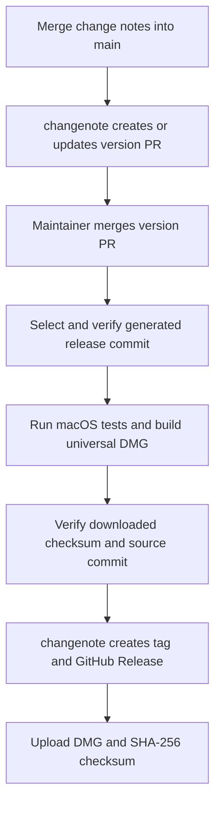

# Releasing Display Loom

Display Loom is distributed outside the Mac App Store as a universal DMG for Intel and Apple Silicon Macs. The app has an ad-hoc signature that preserves its sandbox entitlements and hardened runtime. It has no Developer ID signature or Apple notarization. Gatekeeper can block downloaded copies. This workflow does not require Apple certificates, Apple account secrets, or an Apple Developer Program membership.

## Change notes and versions

[changenote](https://github.com/narumiruna/changenote) manages package `display-loom`. Install the CLI from the same source revision as the workflow Action and configuration schema:

```sh
cargo install --git https://github.com/narumiruna/changenote \
  --rev f4423760122463bf03a8d161c6f0bc4173afb6e0 --locked
```

Upgrade the CLI, Action, and schema pins together. Rust is needed for the changenote CLI, not for the Swift app.

`Configuration/Version.xcconfig` supplies `MARKETING_VERSION` for Debug and Release. Do not override it in `project.yml` or the generated project. A version bump does not require Xcode project regeneration. `CURRENT_PROJECT_VERSION` remains a separate build number in `project.yml`; changenote does not change it.

For a change that affects users or release artifacts, add a note and commit it with the change:

```sh
changenote add improve-display-recovery \
  --package display-loom --bump patch \
  --message "Improve display recovery after wake."
just changes
```

Use `patch` for fixes, `minor` for compatible features, and `major` for breaking changes. Changes without release impact need no note; state the reason in the PR description. Do not create empty notes or run `changenote init` again.

## Automatic release flow

The workflow is `.github/workflows/release.yml`:



1. **Prepare Release PR** runs on pushes to `main`. It creates or updates one PR on `narumi/chore/changenote-release-main`. Reserve this branch for automation. The PR updates the version and `CHANGELOG.md`, saves `.changenote/releases.json`, and removes consumed notes. It never creates a tag or Release.
2. Merging that PR changes the saved batch on `main`. The selection job verifies that the release tree matches changenote's generated changes. Ordinary pushes without a batch change do not publish an older batch. Initial repository pushes do not publish automatically.
3. The macOS job checks out the exact selected commit, runs changenote integration checks, mocked release-script checks, and XCTest without live display changes, and builds both `arm64` and `x86_64` into one app. It applies an ad-hoc signature with the existing sandbox entitlements, creates the DMG with `hdiutil`, and verifies the image.
4. A private Actions artifact retains the DMG, checksum, and source-commit sidecar for seven days. The Ubuntu publication job verifies the checksum and sidecar before any tag or Release write.
5. The pinned changenote Action rechecks the selected commit, creates the annotated `v<version>` tag and GitHub Release, and reads the Release body from that version's `CHANGELOG.md` entry. It does not move existing tags or rewrite existing Release text.
6. The upload script checks the remote tag identity and attaches only the DMG and checksum. The source-commit sidecar is not a public asset.

PR management and publication use separate concurrency groups. A later ordinary commit on `main` does not change the selected release source. If a newer version batch replaces the selected batch before publication, the Action stops before remote writes; inspect the newer release and retry explicitly. Do not merge another version PR until the previous version and its assets are complete.

All required steps are in the same workflow. Tags created with `GITHUB_TOKEN` do not trigger another tag-push workflow.

## GitHub setup

The repository owner must:

1. Enable **Settings > Actions > General > Allow GitHub Actions to create and approve pull requests**.
2. Permit the bot to push the managed release branch. The Action never approves or merges its PR.
3. Permit `contents: write` and `pull-requests: write` for PR management, and `contents: write` for publication. Other jobs use read-only repository permissions.
4. Merge the version PR with a maintainer account or a GitHub App token. Events created with a workflow's `GITHUB_TOKEN` do not start another workflow automatically.

No Apple secrets or protected `release` environment are required. The default `GITHUB_TOKEN` is sufficient for this workflow when repository and organization rules allow the required operations.

PRs created with `GITHUB_TOKEN` do not automatically trigger separate PR CI workflows. If required checks must run before a version PR can merge, use a GitHub App token with repository contents and pull requests write permissions through the Action's `github-token` input. Token setup is an account-owner task; do not put tokens in change notes or source files.

## Manual runs and retries

Open **GitHub > Actions > Release > Run workflow**, select `main`, and choose:

1. **`manage-pr`**: create or update the version PR only. This is the default and cannot publish.
2. **`retry-publication`**: select the latest verified batch, including one whose tag and Release already exist, then rerun tests, packaging, publication, and asset upload. No version input or second version bump is needed.

Retries support DMG batches prepared after this workflow migration. For the first DMG release, merge the workflow changes and their change note, then merge the generated version PR. Do not retry historical ZIP batches with this workflow: those commits contain the old packaging scripts and can require the previous signing setup. Existing tags and Releases are not converted.

Use a full manual retry when no assets have been uploaded. If upload failed after an asset was attached, rerun the failed publication job while its seven-day Actions artifact is available. This reuses the exact packaged bytes. Regenerating a DMG can change its bytes even when the source commit is unchanged.

The upload script checks both existing assets before it uploads missing ones. Matching assets are retained. Different bytes, unexpected asset names, draft Releases, tag conflicts, API errors, or an invalid checksum stop the process. It never uses `--clobber`, deletes an existing asset, or moves a tag. After artifact expiry or an immutable-asset conflict, inspect the existing Release before deciding how to recover; publish a new patch version if a public artifact needs replacement.

A GitHub Release can exist briefly without its DMG if asset upload fails after tag/Release creation. Inspect both the workflow result and the final asset list. Tag creation alone does not establish a completed app release.

## Local packaging

With full Xcode installed, use a clean `main` checkout or a detached release commit that belongs to `origin/main`:

```sh
just test
just package-release 0.2.0
```

The supplied version must match `Configuration/Version.xcconfig`. Packaging creates:

- `.release/Display-Loom-<version>.dmg`
- `.release/Display-Loom-<version>.dmg.sha256`
- `.release/Display-Loom-<version>.dmg.commit`

The DMG contains `Display Loom.app` and an `Applications` shortcut. The `.commit` sidecar records the source `HEAD`. Packaging rechecks `HEAD` and the clean working tree before writing it. Do not modify checksums or sidecars to reuse an old image; rebuild from the intended commit.

Use the GitHub workflow for version publication and tag creation. The local upload command only attaches assets to an existing, non-draft Release whose remote tag points to the packaging commit:

```sh
CONFIRM_PUBLISH=v0.2.0 just publish-release 0.2.0
```

It requires GitHub CLI authentication and does not create a tag or Release. All GitHub Release operations use the repository at `origin`. `GH_REPO` and the GitHub CLI default do not change the upload target. Git tag signing and app code signing are separate: the workflow creates annotated tags, and the app has only an ad-hoc signature.

## Local checks

With the matching changenote CLI, XcodeGen, and uv installed:

```sh
just test-release
```

The suites use temporary fixtures:

- `scripts/test-changenote.py` checks version updates, changelog extraction, generated-project stability, workflow routing, release-range checks, and downloaded-artifact verification.
- `scripts/tests/test_release.py` runs the packaging and upload scripts with a mock-only `PATH`. It checks ad-hoc packaging, architecture and bundle metadata, provenance, checksum rejection, remote conflicts, immutable assets, retries, and shell syntax.

These tests do not create real tags or Releases, access Apple credentials, or change displays. A local package check can build and sign a disposable app and verify its DMG without launching the app. This does not establish hosted workflow behavior, Gatekeeper trust, or live-display compatibility.

### Migration verification

Local checks passed with Xcode 27.2 and the matching changenote 0.10.0 CLI:

- 14 changenote/workflow tests and 42 mocked packaging/upload tests.
- 84 XCTest tests, with one live-display test skipped and no failures.
- Display-safe performance checks, strict Swift lint, Actionlint 1.7.12, ShellCheck, and `git diff --check`.
- A disposable build produced a real universal DMG. A read-only mount confirmed the app, Applications shortcut, ad-hoc signature, hardened runtime, sandbox entitlements, both architectures, checksum, and commit sidecar. The packaged app was not launched.

No remote tag, GitHub Release, or asset was created during these checks. Hosted validation remains an external task below.

## Display-safe performance checks

The existing display regression checks remain separate from release tooling:

```sh
just test-performance
just lint
```

The backend and store checks also have XCTest wrappers. Native bridge checks use fake runtime/display operations. They cover serialized display writes, cancellation and late-handle cleanup, registration deadlines, worker-side mirror guards, notification coalescing, saved mirror intent, stale results, teardown, and resolution ordering. They do not change the host's display configuration or measure real display latency.

Earlier validation recorded 84 XCTest tests with the live test skipped, a universal unsigned Release build, strict Swift lint checks, 15 backend/worker checks, 13 store/service groups, nine fake initializer ownership cases, and three mirror mode guards. These are historical results, not evidence that the new GitHub workflow has run.

## External validation

1. **Hosted release workflow**
   - Responsible role: repository owner or release maintainer.
   - Prerequisite: the workflow changes are merged and the GitHub settings above are enabled.
   - Action: merge a generated version PR, inspect the tag's source commit and Release notes, and confirm that exactly the DMG and checksum are attached. Download and verify the checksum, mount the DMG, and inspect its app and Applications shortcut.
   - Expected result: a universal, ad-hoc-signed app from the verified release commit; no Apple credentials are requested.
   - Unverified behavior: hosted event delivery, permissions, branch rules, artifact transfer, and public upload are not established by local mocks.
   - Release restriction: do not claim notarization, Developer ID trust, Gatekeeper acceptance, or a successful hosted release without corresponding evidence.

2. **Live display behavior and latency**
   - Responsible role: maintainer who can safely change the host's display configuration.
   - Prerequisite: a successful full build, a recoverable test setup, and explicit approval for display changes.
   - Action: after approval, run `just test-live`; check multiple displays, a virtual display used as a mirror primary, rapid source changes, disconnect/reconnect during pending work, source reconnection, and sleep/wake. Use macOS 14 and a current supported version where available, and record missing OS/device coverage.
   - Expected result: saved mirror intent and recovery remain correct, stale operations do not change the final selection, and mirror transactions do not occupy the main thread.
   - Unverified behavior: private API compatibility, real display recovery, menu responsiveness, and system latency are not established by test doubles.
   - Release restriction: observed safety or recovery failures block release. Do not claim measured latency gains or complete live-display validation without this evidence.

## Rollback

Before publication, restore the previous workflow and scripts if needed. Do not edit committed release batches or move published tags. Resolve remote conflicts explicitly rather than deleting public artifacts automatically. Once a release has been downloaded, use a new patch version for corrections.
